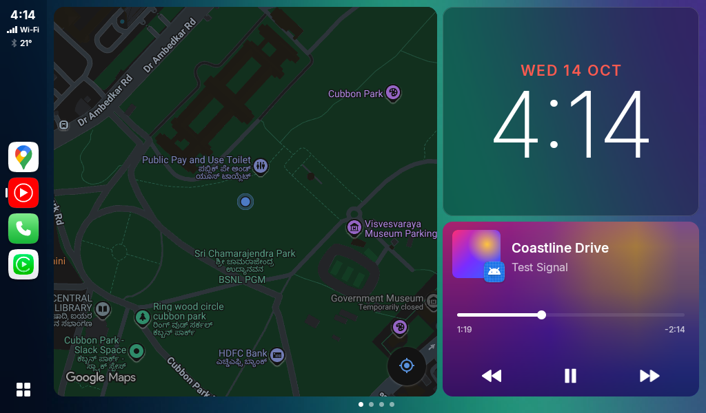
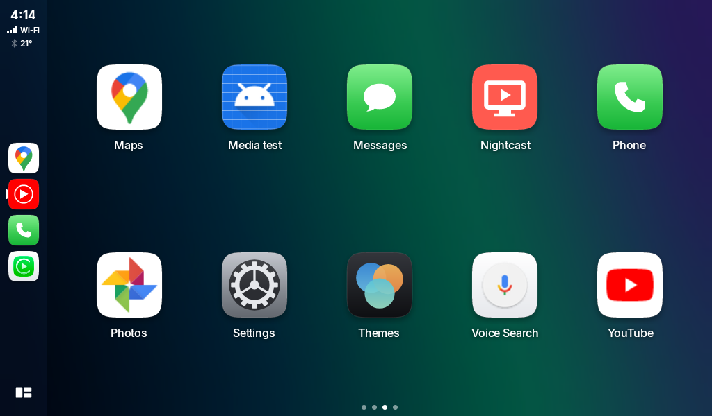
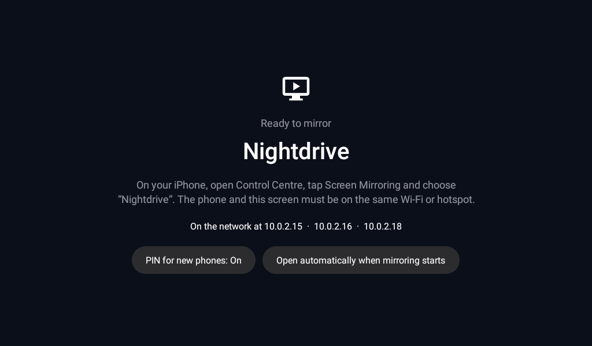

# Nightdrive

One Android app for an aftermarket car head unit, in two parts:

- **Nightdrive** — a home-screen launcher built for a wide landscape display.
- **Nightcast** — an AirPlay-compatible receiver, so an iPhone can mirror its screen and play audio to the head unit.

Both ship in a single APK. Nightcast appears as its own icon in the launcher's app grid and runs in a separate process, so a fault in the receiver cannot take the home screen down. The app targets Android 8.0 and later (API 26+) and is written in Kotlin with plain Android views.

> **Status.** Nightdrive runs on a head-unit emulator. Nightcast has only been tested there too: against a simulated phone, never a real iPhone. Treat everything in the Nightcast section as "built, not yet proven".

## Nightdrive (launcher)

`app/`





- A dashboard of two cards you can rearrange: map, now playing, clock, date and weather.
- A live map without an API key or Play Services, and the current turn from your navigation app.
- Now-playing controls for whichever app is playing, read from its media session.
- A sidebar dock for your most-used apps, plus a full app grid.
- Light, dark and time-of-day appearance, built-in wallpapers, or a photo of your own.
- Weather from [Open-Meteo](https://open-meteo.com/), which needs no account.

`mediatest/` is a small helper app that publishes a fake "now playing" session, for checking the media card on an emulator.

## Nightcast (AirPlay-compatible receiver)

`nightcast/` — an Android library that the launcher app includes.



The protocol work is done by [UxPlay](https://github.com/FDH2/UxPlay)'s C library, built with the NDK and wrapped in JNI. Kotlin handles decoding, playback and the screen.

What it is built to do:

- **Screen mirroring** with sound, the picture timed against the audio so lips stay in sync.
- **Music** with title, artist and cover art, published as a media session so the launcher's card shows it.
- **Casting** from apps with an AirPlay button, such as YouTube.
- **Photos and slideshows** from the classic AirPlay photo protocol.
- **PIN pairing**: a new phone types a 4-digit code shown on the head unit, once.
- **Play, pause and skip** sent back to the phone.

To use it, put the phone and the head unit on the same Wi-Fi (or join the head unit to the phone's hotspot), open Nightcast from the app grid once, and choose it under Screen Mirroring in the iPhone's Control Centre.

### Known limits

- **No touch control.** AirPlay carries nothing from the screen back to the phone.
- **Protected video shows black.** Netflix, Prime Video, Disney+ and similar cannot be mirrored or cast.
- **About a quarter-second delay** when mirroring, capped at 30 frames per second.
- **One phone at a time.** A second paired phone takes over from the first.
- **The PIN covers mirroring and audio only.** Photos, slideshows and casts can be started by anything on the same network.
- **No multi-room audio, 4K or H.265.**
- Photos and slideshows follow the community-documented protocol from older iOS versions; current iOS may not use it.

## Building

You need JDK 17 and the Android SDK with platform 35, NDK `27.2.12479018` and CMake `3.22.1`. Point Gradle at the SDK in `local.properties`:

```
sdk.dir=/path/to/android/sdk
```

Then:

```bash
./gradlew :app:assemblePublicDebug
```

The APK, containing both the launcher and the receiver, lands in `app/build/outputs/apk/public/debug/`.

Device tests for Nightcast's video decoder and casting player, with an emulator or device attached:

```bash
./gradlew :nightcast:connectedPublicDebugAndroidTest
```

### Editions

The app builds as `public` or `personal`. `public` is exactly what is in this repository. `personal` also picks up a git-ignored `src/personal/` folder, for resources that should not be published (for example your own wallpapers; see `Themes.all()`). Without that folder the two are identical.

## Licences

The repository holds code under different licences, so there is no single licence file at the top level.

- **The built APK is GPL-3.0 as a whole**, because it contains Nightcast. If you pass the APK on, the GPL's terms apply to all of it.
- **Nightcast is GPL-3.0**, because it links UxPlay. See [`nightcast/LICENSE`](nightcast/LICENSE) and [`nightcast/NOTICE`](nightcast/NOTICE) for the bundled code: UxPlay, libplist and an ALAC decoder. Local changes to UxPlay are listed in [`nightcast/src/main/cpp/third_party/VERSIONS.txt`](nightcast/src/main/cpp/third_party/VERSIONS.txt).
- **The Inter typeface** used by the launcher is under the SIL Open Font License; see [`INTER-LICENSE.txt`](INTER-LICENSE.txt).
- **The launcher's source and the media test helper are MIT-licensed**, so the launcher code can be reused on its own without Nightcast; see [`app/LICENSE`](app/LICENSE) and [`mediatest/LICENSE`](mediatest/LICENSE).

AirPlay, iPhone and CarPlay are trademarks of Apple Inc. This project is not affiliated with or endorsed by Apple.
